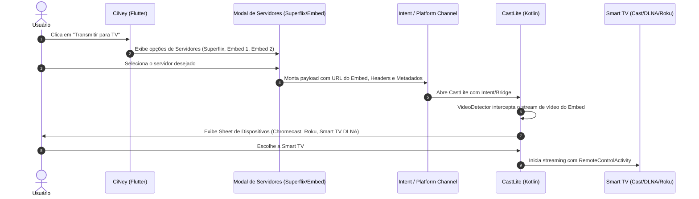

# PLAN: Ponte de Transmissão CiNey ➔ CastLite (Google Cast, DLNA e Roku)

> **Data:** 13/10/2026
> **Status:** Proposto / Planejamento
> **Objetivo:** Permitir que o usuário assista ou transmita conteúdos do **CiNey** (Flutter) para qualquer Smart TV (Chromecast/Google Cast, DLNA/Smart TVs Samsung/LG, e Roku) usando o mecanismo nativo de sniffing e casting do **CastLite** (Android/Kotlin).

---

## 1. Visão Geral da Arquitetura

O **CiNey** é um aplicativo Flutter que consome múltiplos plugins de catálogo (Superflix, Embeds, etc.) e resolve fontes de reprodução (`StreamSource`) que podem ser:
1. **Vídeos diretos/HLS (`.m3u8`, `.mp4`)**
2. **Páginas Embed / WebViews** (como as do Superflix e servidores protegidos por tokens, headers ou sniffing de player).

O **CastLite** é um aplicativo Android nativo Kotlin otimizado para:
- Navegação web segura com interceptação automática de streams (`VideoDetector`).
- Servidor proxy local HTTP com suporte a byte-range e DRM/ClearKey (`LocalMediaProxy`).
- Descoberta e transmissão multiplataforma com controle remoto unificado (`GoogleCastTarget`, `DlnaCastTarget`, `RokuCastTarget`).

---

## 2. Modelos de Integração Possíveis

### Opção A: Comunicação Inter-App via Android Intent / Deep Link (Recomendada para início rápido e isolamento)
- **Como funciona:** O CiNey e o CastLite operam como dois aplicativos irmãos. Ao clicar no botão de "Transmitir" no CiNey (ou ao abrir o diálogo de servidores), o CiNey dispara um `Intent` Android customizado (ex: `castlite://cast` ou `action.VIEW`) passando no `Bundle`:
  - `url`: URL direta ou URL do Embed (Superflix, etc.)
  - `title`: Nome do filme / episódio
  - `posterUrl`: Banner do conteúdo
  - `headers`: Map de headers (Referer, User-Agent)
  - `servers`: Lista serializada em JSON dos servidores disponíveis (Superflix Dublado, Embed Legendado, etc.) para troca rápida
  - `positionMs`: Posição atual para retomar de onde parou
- **Vantagens:**
  - Zero risco de conflitos de dependências entre Flutter e Kotlin nativo do CastLite.
  - O CastLite pode ser atualizado de forma independente.
  - Implementação imediata em poucas horas.
- **Desvantagem:** Requer os dois APKs instalados no dispositivo do usuário.

---

### Opção B: Integração Nativa Embutida (Módulo Android / AAR / Flutter Plugin)
- **Como funciona:** O código do CastLite é empacotado como uma Android Library (`.aar` ou submódulo Gradle `castlite_engine`) e exposto ao CiNey através de um **MethodChannel / Platform Channel** em Dart/Kotlin.
- **Como funciona na prática:**
  - O botão de transmissão dentro do player ou dos detalhes do CiNey abre uma interface nativa do CastLite sobreposta (ou BottomSheet Flutter acionando o CastLite em background).
  - O usuário nunca sai do CiNey; é um único aplicativo coeso.
- **Vantagens:** Experiência 100% transparente para o usuário final, sem necessidade de baixar um segundo app.
- **Desvantagem:** Maior tamanho do APK do CiNey e necessidade de integrar o ciclo de vida dos serviços de rede (jUPnP, SSDP, Cast SDK) dentro do app Flutter.

---

## 3. Especificação do Fluxo (CiNey ➔ CastLite)



---

## 4. Plano de Implementação Passo a Passo

### Fase 1: Padronização do Contrato de Comunicação (Payload)
- Criar especificação JSON compartilhada entre CiNey e CastLite:
  ```json
  {
    "action": "cast_media",
    "title": "Deadpool & Wolverine",
    "posterUrl": "https://...",
    "sourceUrl": "https://superflixapi.top/...",
    "isEmbed": true,
    "headers": {
      "Referer": "https://superflixapi.top/"
    },
    "servers": [
      { "name": "Superflix Dublado", "url": "https://...", "isEmbed": true },
      { "name": "Embed Legendado", "url": "https://...", "isEmbed": true }
    ],
    "resumePositionMs": 142000
  }
  ```

### Fase 2: Adaptação no CastLite (Receptor)
1. **Configuração de Intent Filter no `AndroidManifest.xml`:**
   - Registrar esquema customizado: `<data android:scheme="castlite" android:host="play" />`
   - Suporte a `android.intent.action.VIEW` e `android.intent.action.SEND`.
2. **Tratamento no `MainActivity.kt` do CastLite:**
   - Método `handleIncomingCastIntent(intent: Intent)`.
   - Se `isEmbed == true`, carregar a URL no WebView com auto-sniffing pelo `VideoDetector`.
   - Se stream direto (`.m3u8` ou `.mp4`), pular o WebView e abrir imediatamente o seletor de TVs.
   - Adicionar menu suspenso ou BottomSheet no CastLite para alternar entre os servidores recebidos no payload sem precisar voltar ao CiNey.

### Fase 3: Adaptação no CiNey (Emissor)
1. **Botão de Transmissão no Player (`player_screen.dart`):**
   - Atualizar `_castToTv()` para verificar se o app CastLite está instalado via `android_intent_plus` ou `url_launcher`.
   - Se não instalado, oferecer botão de instalação ou exibir diálogo explicativo com link direto.
2. **Integração no Seletor de Servidores (`server_selection_sheet.dart`):**
   - Adicionar ação rápida: "Transmitir este servidor para TV".

### Fase 4: Validação e Testes E2E
- Testar transmissão de filme via Superflix para:
  1. Chromecast (Google Cast)
  2. Smart TV Samsung / LG (DLNA)
  3. Roku TV (ECP)
- Testar troca de servidores em tempo real.
- Validar retomada da posição (`resumePositionMs`).

---

## 5. Critérios de Sucesso
- [ ] Usuário clica em "Transmitir" no CiNey e o CastLite abre automaticamente com o filme carregando.
- [ ] O `VideoDetector` do CastLite extrai com precisão o stream real do Embed Superflix sem propagandas na TV.
- [ ] A Smart TV recebe o stream correto e os controles (Play, Pause, Seek, Volume) funcionam de forma sincronizada.
